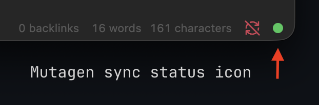
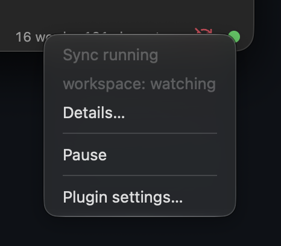

# Mutagen Sync for Obsidian

See and control [Mutagen](https://mutagen.io) sync of your vault without a terminal: a status bar dot shows whether the vault's Mutagen project (`mutagen.yml` in the vault root) is syncing, and a click starts, pauses or resumes it.

 

Requires Obsidian desktop and the `mutagen` CLI (path configurable in settings).

- grey - no `mutagen.yml`, no `mutagen` binary, or project not started
- yellow - sync paused
- green - sync running
- red - sync error

Click the dot: `mutagen project list` output, Start / Pause / Resume, Settings. Without a config the menu offers to create `mutagen.yml` from a template set in settings. Right-click the dot to pause or resume instantly. Status is pushed by a single `mutagen sync monitor` process, no polling.

When you close the vault while it is syncing, the plugin can ask whether to pause the project, pause it silently, or do nothing (setting *When closing the vault while syncing*).

**SSH with a password.** The plugin runs mutagen without a terminal, so it cannot ask for an SSH password: Start fails right away with a hint and cleans up after itself. Use *Start in terminal* from the menu (enter the password there; on Linux the terminal can be set in settings), or better, set up an SSH key (`ssh-copy-id user@host`, with ssh-agent or macOS Keychain for a passphrase) so Start and reconnects work without prompts.

**The Mutagen daemon.** The plugin never starts the daemon itself: a daemon started from Obsidian outlives it, and the OS then shows Obsidian as running in the background. Run `mutagen daemon register` once so the daemon starts at login, or use *Start daemon in terminal* / *Start in terminal* from the menu.

For troubleshooting, enable *Debug log* in settings (off by default): mutagen calls and state changes go to `debug.log` in the plugin folder and the developer console.

## Install via BRAT

1. Install the **BRAT** community plugin.
2. BRAT -> *Add beta plugin* -> `artemc/obsidian-mutagen-plugin`.
3. Enable **Mutagen Sync**. BRAT pulls new releases automatically.

## Release

```sh
npm version patch   # bumps package.json, manifest.json, versions.json, creates tag
git push --follow-tags
```

GitHub Actions builds and publishes a release with `main.js`, `manifest.json`, `styles.css`.

---

Made with [Claude Code](https://claude.com/claude-code).
